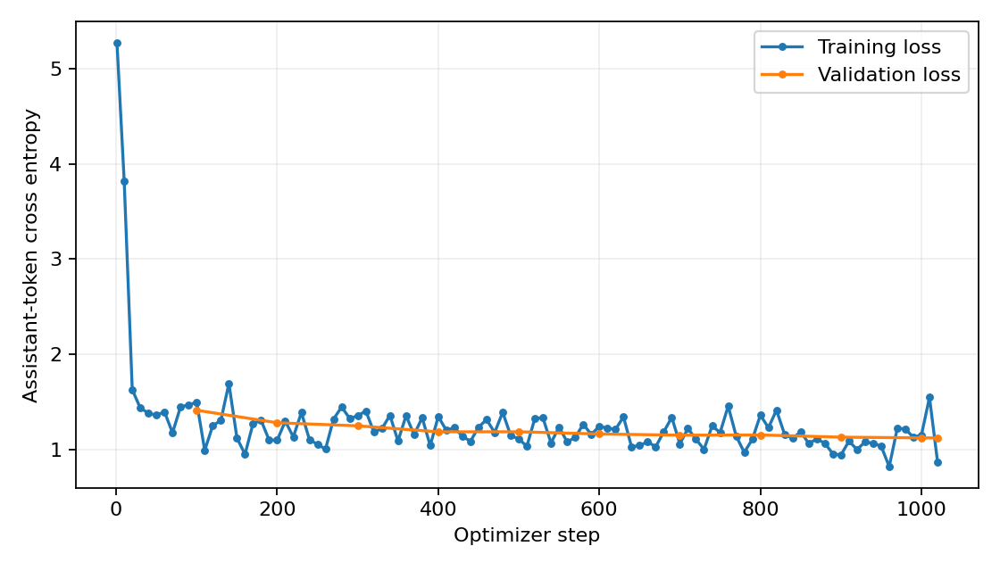

# Small LLM QA: Few-Shot Retrieval and QLoRA

A reproducible comparison of example selection and lightweight fine-tuning for a small language model. The project uses Qwen3-1.7B for general question answering, question answering over supplied passages, and numerical mathematics problems, with a shared evaluation pipeline and a single-GPU training setup.

Four conditions are compared: a zero-shot baseline, random same-task demonstrations, semantically similar same-task demonstrations, and QLoRA supervised fine-tuning without demonstrations. The experiment records answer quality, token usage, latency, memory, and changes in abstention behavior.

The dataset calls the passage-based task `rag`. Its passages are already provided with each question. MiniLM retrieves **training demonstrations**, not external documents.

## Results

The completed experiment evaluates all four methods on the same 1,007 test inputs: 330 QA, 350 passage-based QA, and 327 mathematics questions. Every score below is a percentage.

| Method | QA EM | QA token F1 | Passage QA EM | Passage QA token F1 | Math accuracy | Composite score |
| --- | ---: | ---: | ---: | ---: | ---: | ---: |
| Zero-shot baseline | 0.61 | 5.26 | 22.00 | 26.39 | 3.67 | 11.77 |
| Random demonstrations | 6.36 | 11.24 | 32.29 | 38.00 | 9.48 | 19.57 |
| Similar demonstrations | 10.00 | 15.91 | 36.86 | 43.32 | 11.62 | 23.62 |
| QLoRA SFT | 14.55 | 20.63 | 62.86 | 71.41 | 24.46 | 38.84 |

The composite score is the unweighted task average:

```text
(QA token F1 + passage-QA token F1 + math numerical accuracy) / 3
```

It is not pooled answer accuracy. Similar demonstrations improve the composite score over random demonstrations by **4.04 percentage points**. SFT improves over the zero-shot baseline by **27.07 percentage points**. Differences are calculated from unrounded scores, so subtracting the displayed two-decimal values can differ by 0.01 point.

SFT produces the strongest measured results, but substantial errors remain. Its math answers all satisfy the numeric parser, while only 80/327 are numerically correct. In passage QA, incorrect refusals fall from 181 to 21 out of 290 answerable questions; correct refusals on the 60 unanswerable questions also fall from 51 to 30. Better aggregate F1 therefore does not imply uniformly better abstention.



## What the pipeline does

- Checks agreement between tabular and conversation-format training records, then creates a deterministic, task-stratified train/validation split.
- Audits normalized exact question and question-plus-context overlaps. Shared sources, paraphrases, and pretraining contamination are still possible.
- Selects demonstrations only from the training split. Similarity selection uses normalized MiniLM question embeddings, same-task filtering, and deterministic tie-breaking.
- Counts the rendered chat template exactly and removes lower-priority demonstrations to fit the input budget, retaining the target question and supplied passages.
- Trains LoRA adapters on a frozen 4-bit base model, with loss restricted to assistant answers and the answer terminator.
- Freezes configuration and checks complete, consistent prediction sets before final test scoring.
- Saves metrics, runtime statistics, training history, manifests, and checksums for inspection.

## Recorded setup

| Component | Setting |
| --- | --- |
| Base model | `Qwen/Qwen3-1.7B`, pinned revision |
| GPU | NVIDIA Tesla T4 |
| Quantization / computation | 4-bit NF4, double quantization / FP16 |
| Inference | Thinking disabled; greedy decoding; one beam |
| Token limits | 2,048 input tokens; 128 new tokens |
| Example encoder | `sentence-transformers/all-MiniLM-L6-v2`, pinned revision; CPU |
| Demonstration count | Common requested `n=5`, selected on a fixed validation subset |
| SFT | One epoch; learning rate `2e-4`; batch size 1; accumulation 8 |
| LoRA | Rank 16; alpha 32; dropout 0.05; attention q/k/v/o projections |
| Trainable parameters | 6,422,528 |
| Training peak allocated GPU memory | Approximately 4.01 GiB |

Requested and actual demonstration counts can differ when passages consume the prompt budget. The 4.01 GiB figure measures PyTorch allocated memory, not total GPU use or reserved memory.

The completed training call took approximately 125.19 minutes, including its scheduled evaluations and checkpoint saves. The four test generation runs took approximately 43.89 minutes in total. Model loading, retrieval preparation, prompt construction, and other overhead are excluded from that generation total. See [the experiment record](docs/experiment.md) for timing scopes and interpretation.

## Try the code

The synthetic demo runs on CPU without downloading a model or obtaining the original dataset. From the repository root, run:

```bash
python scripts/demo.py
python scripts/check_release.py
```

The release manifest checks this distribution's file contents. After intentional
edits, regenerate it with `python scripts/check_release.py --write-manifest` and
commit the updated manifest. Historical experiment results should remain
separate from newly generated runs.

For the full CPU test suite, install the small test dependency set first. It
includes the pinned Transformers configuration utilities used by the generation
regression tests, and does not install model weights or PyTorch:

```bash
python -m pip install -r requirements-test.txt
```

Then make `src` importable. On Linux or macOS:

```bash
PYTHONPATH=src python -m unittest discover -s tests -v
```

On PowerShell:

```powershell
$env:PYTHONPATH = "src"
python -m unittest discover -s tests -v
```

Python 3.11 was used for the recorded GPU experiment. The synthetic checks do not reproduce its model scores.

## Run the full experiment

Open [the notebook](notebooks/Small_LLM_QA.ipynb) in Google Colab and follow its setup, data preparation, validation, training, and evaluation cells. It installs the pinned GPU dependencies and starts with runtime and data checks. Use a GPU runtime for quantized inference and training; run the smoke checks before a full job.

The supplied configuration targets FP16 on a T4. On a GPU with native BF16,
the precision guard requires a matching configuration. Use `compute_dtype: "auto"`
in a fresh configuration and workspace to resolve precision for that hardware;
record the changed setting rather than mixing its outputs into the T4 results.

The original mixed dataset was supplied for coursework and is not redistributed here. Provide an authorized copy in the format described in [docs/DATA.md](docs/DATA.md). Model weights, adapter weights, complete original predictions, private Drive links, and the original dataset are excluded from this package. A fresh reproduction requires obtaining the data and downloading the model dependencies.

The files in `results/` summarize the completed frozen experiment. The public package has been prepared for reuse, but has not been rerun end to end on a GPU after packaging. Updated results should be saved separately from these historical records.

## Repository layout

```text
configs/                  Experiment configuration
docs/DATA.md              Data requirements and access notes
docs/experiment.md        Protocol, metrics, findings, and limitations
notebooks/Small_LLM_QA.ipynb
results/                  Aggregate metrics, statistics, and training history
scripts/demo.py           Synthetic CPU demonstration
scripts/check_release.py  Package checks
src/small_llm_qa/         Preparation, retrieval, prompting, training, and evaluation
tests/                    Data, metrics, provenance, and workflow checks
```

## Scope and limitations

This is one experiment with a single model, seed, and GPU setting. It includes no repeated-seed study, statistical significance claim, production deployment, or external document search. QA and math performance remain limited. The fixed non-thinking greedy policy does not establish the model's best achievable performance.

The existing test results are for explaining the frozen experiment. Further prompt, retrieval, or training choices should use validation data; a separate unseen evaluation set is needed to confirm subsequent improvements.

## References

- [Qwen3-1.7B model card at the recorded revision](https://huggingface.co/Qwen/Qwen3-1.7B/blob/70d244cc86ccca08cf5af4e1e306ecf908b1ad5e/README.md)
- [all-MiniLM-L6-v2 model card at the recorded revision](https://huggingface.co/sentence-transformers/all-MiniLM-L6-v2/blob/1110a243fdf4706b3f48f1d95db1a4f5529b4d41/README.md)
- [PEFT quantization documentation](https://huggingface.co/docs/peft/v0.15.0/en/developer_guides/quantization)

See [LICENSE.txt](LICENSE.txt), [NOTICE.txt](NOTICE.txt), and [data documentation](docs/DATA.md)
for distribution and attribution notes. The original code is published with
rights reserved; no open-source code license has been selected. Third-party
models, libraries, and data retain their own terms.
